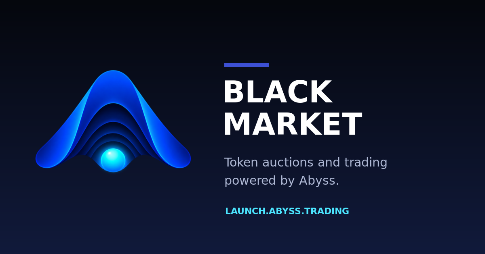

# Abyss Black Market Launch

Claude Code and Codex harness for designing and simulating oracle-enabled Abyss token launches.



## Start here

Clone this harness, start Claude Code or Codex from the cloned directory, and paste the following prompt. Replace `/absolute/path/to/your/repository` with the local repository that contains the Abyss-compatible launch contracts and deployment configuration.

```text
Use the abyss-token-launch skill to guide me through designing and simulating a token launch against the repository at /absolute/path/to/your/repository.

Begin by inspecting that repository's launch contracts, SDK, deployment records, registered oracle configurations, fee tiers, templates, tests, and pinned toolchain. Then walk me through each decision rather than assuming defaults:

1. Explain Standard Oracle versus Quote Oracle pool accounting and ask me which one I want. Never offer a non-oracle pool.
2. Explain a standard launch versus each custom launch design actually supported by the repository, then ask me to choose.
3. Collect every required token, quote asset, fee, distribution, and creator parameter.
4. Look up the current USD price of the exact quote-token contract, show the source and UTC timestamp, and ask me to confirm it. If no reliable source exists, ask me for the price.
5. Recommend a launch near $5,000 FDV, derive the exact tick, liquidity, and effective FDV with repository-native integer math, and ask me to confirm the complete parameter table.
6. Ask whether I want an initial buy. Default to slippage protection, but let me explicitly ignore slippage after warning me and confirming that the repository supports an unbounded buy.
7. Generate rigorous repository-native tests and launch artifacts, run the focused tests and local or fork simulation, and report the observed results.

Do not broadcast any transaction, request or inspect a private key or keystore, ask for wallet approval, or add a broadcast option. Stop after successful simulation.
```

The agent should begin with the pool-profile explanation and first question. It should not generate launch artifacts until the design, live quote price, derived pricing, and initial-buy policy have been explicitly confirmed.

The wizard walks users through:

- Standard Oracle versus Quote Oracle pool accounting
- Standard versus supported custom launch templates
- Token name, ticker, supply, decimals, quote asset, fee tier, and fee distribution
- Current quote-token USD price confirmation
- Launch pricing near a recommended $5,000 fully diluted valuation
- Optional initial buy with protected or explicitly unbounded slippage
- Repository-native launch artifacts and rigorous contract, SDK, lifecycle, and fork tests

## Safety boundary

This harness generates, tests, and simulates launches. It never broadcasts transactions, requests private keys, opens keystores, or asks for wallet approval.

## Use with Codex

Clone the repository, start Codex from its root, and paste the complete prompt in [Start here](#start-here). `AGENTS.md` directs Codex to the canonical skill at:

```text
.agents/skills/abyss-token-launch/SKILL.md
```

The prompt's absolute target-repository path tells the harness where to inspect and generate launch artifacts.

## Use with Claude Code

Start Claude Code from the repository root and paste the complete prompt in [Start here](#start-here). `CLAUDE.md` loads the shared instructions, and the Claude skill path is a symlink to the same canonical source:

```text
.claude/skills/abyss-token-launch/SKILL.md
```

Claude Code and Codex therefore follow one workflow rather than duplicated instructions.

## Workflow

The harness instructs the agent to:

1. Inspect the target repository's contracts, SDK, deployment records, registered templates, fee tiers, oracle configuration, and toolchain.
2. Explain the supported design choices and collect every required launch parameter.
3. Retrieve and confirm the quote token's current USD price, or request a user-supplied price when no reliable source exists.
4. Derive the launch tick, liquidity, effective FDV, initial-buy estimate, and execution limits using repository-native integer math.
5. Present one complete confirmation record.
6. Generate parameter preparation, launch simulation, and test artifacts in the target repository.
7. Run focused tests, a full local lifecycle, and a canonical fork simulation where supported.
8. Stop without broadcasting.

The target repository remains authoritative. The harness does not hard-code a particular deployment, ABI, address set, or toolchain.

## Slippage

Slippage protection is the default for a nonzero initial buy. A user may explicitly ignore it after acknowledging that execution can receive materially less than the estimate. The generated request uses unbounded values only when the target contracts support them and the user confirms the choice.
